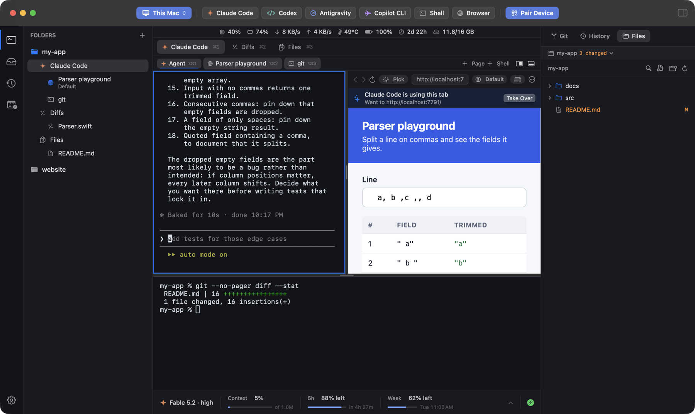
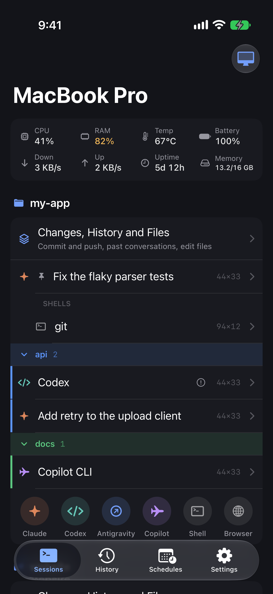
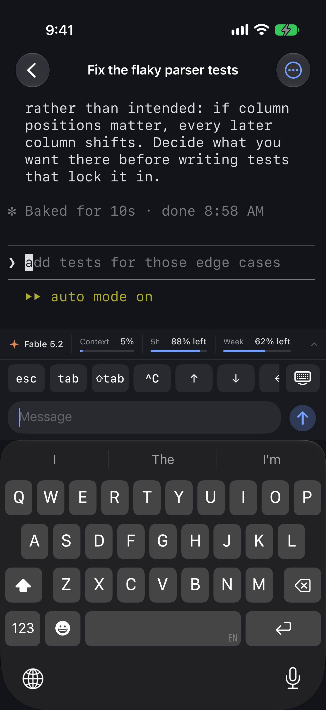
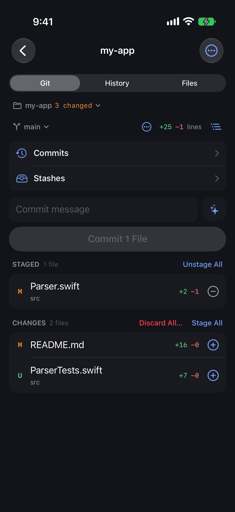
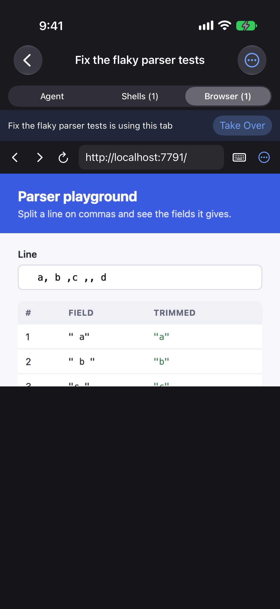

<div align="center">

# AgentTerm

**A native Mac terminal for coding agents, with a built-in browser and MCP tools, and an iPhone remote.**

Run Claude Code, Codex, Antigravity and GitHub Copilot CLI on your Mac.
Give them shells and a browser you can watch, and steer the same sessions from your iPhone.

[](https://github.com/manhpham90vn/AgentTerm/actions/workflows/ci.yml)
[](https://github.com/manhpham90vn/AgentTerm/releases)
[](LICENSE)

[](https://discord.gg/Ksagmsd6j)



</div>

AgentTerm runs each agent in a real terminal owned by a small host program on
your Mac, so sessions keep running when the window is closed, and your iPhone
reaches them over [Tailscale](https://tailscale.com). The agents work in the
open: the shells they run commands in and the pages they browse are tabs you
can see, use and take over.

> **Status: beta.** Use the same version of the Mac and iPhone apps; see [Compatibility](#compatibility).

## Features

**Agents and sessions**

- **Every agent, one click.** Starts any of the four agent CLIs installed on
  your Mac in a real terminal, in a project folder or a new Git worktree.
- **Sessions that keep running.** Close the window or quit the app; they are
  still there, and the app can stay in the menu bar.
- **What each agent is doing**, at a glance: working, asking a question,
  waiting for permission, done, with its model, context and what your
  account has left, and what its last turn ran and changed.
- **Schedules.** Start an agent with a prompt at a time, every day, every so
  many hours, or once its account limit starts over; the host runs them with
  the app closed.
- **Handoff.** Pass a conversation's work to another agent when one runs out
  of quota, in the same folder or another one.

**Tools the agents use, in plain sight**

- **Built-in MCP server.** Agents open shells you can see, run commands and
  read their output; you can type in those shells too, from the Mac or the
  iPhone.
- **A Chromium browser in the app.** Agents open pages beside them, read,
  click, type, fill forms and check their work, each in a tab you can watch
  and take over. It is your browser too, with profiles, private tabs, device
  sizes and developer tools; pick an element on a page to send it to an
  agent.

**Your workspace (Mac)**

- **Tabs you arrange.** Each agent with its own page and shells beside it;
  your shells, pages, files and diffs in tabs of their own, ⌘1 to ⌘9 and
  ⌥⌘1 to ⌥⌘9 to pick them. A Shells tab splits in three, as an agent's does.
- **Git, files and history** of each folder next to the terminal: stage,
  commit, push and pull, have an agent write the commit message, edit files,
  preview Markdown as GitHub shows it, resume a past conversation.
- **The Mac at a glance**: processor, memory, network, temperature, battery,
  and a switch to keep the Mac awake while agents work.
- **SSH hosts** of your `~/.ssh/config`, one click each.
- **Another Mac**: pair a second Mac and work on its sessions, files and
  browser from this one.

**When an agent needs you**

- **Inbox.** What agents asked and finished, and what stopped, kept for 30
  days on each device; read on one device is read on all of them.
- **Notifications on the Mac and the iPhone at once**, through Apple while the
  iPhone app is asleep, end-to-end encrypted for your iPhone. Answer from the
  notification. A finished agent is told after 30 seconds, and not at all if
  you already looked.
- **A Live Activity** on the iPhone's lock screen with what the Mac's agents
  are doing.

**iPhone remote**

Pair with a QR code and get the same sessions, folders, Git, files, browser
pages, schedules and usage on your phone, with a key bar and a compose field
made for prompts. The agents keep running on the Mac.

<p>




</p>

## Install

**Mac, with [Homebrew](https://brew.sh):**

```sh
brew tap manhpham90vn/tap
brew trust manhpham90vn/tap     # Homebrew 7 and later: a tap outside Homebrew's own has to be trusted first
brew install --cask agentterm
```

`brew upgrade --cask agentterm` gets a newer version later.

**Mac, by hand:** download the latest `AgentTerm-<version>.dmg` from
[Releases](https://github.com/manhpham90vn/AgentTerm/releases), open it and
drag AgentTerm to Applications.

Either way the app is signed and notarized. It is built for Apple silicon.

**iPhone:** [join the beta on TestFlight](https://testflight.apple.com/join/Ny2JKHUp).

Requirements: macOS 14 or later, iOS 17 or later, at least one agent CLI
installed on the Mac, and [Tailscale](https://tailscale.com) on both
devices, signed in to the same account, for the iPhone to reach the Mac.

### Getting started

1. Open AgentTerm on the Mac and add a project folder. While an agent on
   your Mac misses AgentTerm's hooks or MCP server, an onboarding walks you
   through setting it up, the permissions macOS asks for and pairing; each
   step can be skipped and done later in Settings.
2. Start an agent with its button in the toolbar.
3. Click **Pair Device**, and scan the code with the iPhone app.

## Compatibility

The Mac app, its host and the iPhone app talk over a versioned protocol, so
use versions from the same row.

| Mac app | iPhone app | Protocol |
|---|---|---|
| 0.13.x | 0.13.x | 34 |
| 0.12.x | 0.12.x | 32 |
| 0.11.x | 0.11.x | 31 |
| 0.10.x | 0.10.x | 28 |
| 0.8.x, 0.9.x | 0.8.x, 0.9.x | 22 |
| 0.7.x | 0.7.x | 15 |
| 0.6.x | 0.6.x | 7 |
| 0.4.x, 0.5.x | 0.4.x, 0.5.x | 6 |
| 0.2.x, 0.3.x | 0.2.x, 0.3.x | 5 |
| 0.1.x | 0.1.x | 4 |

Versions from different rows are not supported together. Update both apps
when you update one, and restart the host when the Mac app offers to.

## Security and privacy

The host listens only on `127.0.0.1` and the Mac's Tailscale address. An
iPhone pairs with a one-time code and gets a token of its own, which the Mac
can revoke. Terminals, files and pages go between your devices over
Tailscale only.

Notifications to the iPhone while its app is asleep go through Apple's push
service by way of a small relay the developer runs. The Mac encrypts each one
for your iPhone alone: the relay and Apple cannot read it, and the relay keeps
nothing. A build from source has no relay.

To show account usage, AgentTerm reads each agent's sign-in on your Mac and
sends it only to the service that issued it (`agenttermd --no-account-usage`
turns that off). The released apps can send crash reports and counts of which
features are used through Firebase, each with a switch asked at the first
launch, and nothing before it is answered; never terminal content, prompts,
file names or folders. A build from source sends nothing. Details in
[SECURITY.md](SECURITY.md) and [PRIVACY.md](PRIVACY.md).

## Documentation

- [docs/SPEC.md](docs/SPEC.md): everything the product does
- [docs/DESIGN.md](docs/DESIGN.md): architecture and protocol
- [docs/DEVELOPMENT.md](docs/DEVELOPMENT.md): build from source, tests, code layout, contributing
- [docs/TESTING.md](docs/TESTING.md): how it is tested
- [docs/RELEASE.md](docs/RELEASE.md): how releases are made
- [Issues](https://github.com/manhpham90vn/AgentTerm/issues) and [milestones](https://github.com/manhpham90vn/AgentTerm/milestones): planned work and known bugs
- [SUPPORT.md](SUPPORT.md): getting help
- [Discord](https://discord.gg/Ksagmsd6j): questions, ideas and news

## License

[MIT](LICENSE). Third-party software is listed in
[THIRD_PARTY_NOTICES.md](THIRD_PARTY_NOTICES.md).
